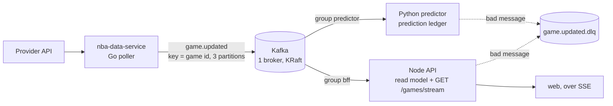

# Kafka event contract

Single-broker Kafka (KRaft, no ZooKeeper) for local and desktop use. Private to the Docker network.

## Architecture



The Go poller publishes only when a game is new or its status or score changed. Each consumer keeps its own offsets. The Node consumer dedupes on `eventId` in memory. The Python consumer dedupes in SQLite, in the same transaction as the ledger write.

Compose services: `kafka`, `kafka-init`, `predictor-consumer` (runs `python -m src.events.consumer`).

## Topics

| Topic | Partitions | Key | Producer | Consumers (group) |
| --- | --- | --- | --- | --- |
| `game.updated` | 3 | game id | `nba-data-service` | `bff`, `predictor` |
| `game.updated.dlq` | 1 | original key | the consumer that failed | none (inspect by hand) |

Created by the `kafka-init` job in `docker-compose.yml`. Re-running it is safe.

## Message

- Key: `game.id`, so all events for one game stay in order on one partition.
- Value: JSON that matches `schemas/game.updated.v1.json`.
- `eventId` is a UUID made at publish time. A redelivered message keeps its id, so consumers dedupe on it.
- Producers send only when a game is new or its `statusKind` or `score` changed.

## DLQ message

Same key and value as the original. Added headers:

- `dlq-reason`
- `dlq-source-topic`, `dlq-source-partition`, `dlq-source-offset`
- `dlq-consumer-group`

## Config

- Containers: `KAFKA_BROKERS=kafka:9092`.
- Host tools and integration tests: `localhost:29092`.
- When `KAFKA_BROKERS` is unset, every service skips Kafka and runs as before.

## Operate

```sh
docker compose exec kafka /opt/kafka/bin/kafka-consumer-groups.sh --bootstrap-server kafka:9092 --describe --all-groups
docker compose exec kafka /opt/kafka/bin/kafka-console-consumer.sh --bootstrap-server kafka:9092 --topic game.updated --from-beginning --max-messages 5
# Reset a group to the start (stop its service first):
docker compose exec kafka /opt/kafka/bin/kafka-consumer-groups.sh --bootstrap-server kafka:9092 --group predictor --topic game.updated --reset-offsets --to-earliest --execute
```

## Lag output

Captured from a local run: the Go container (fixture provider) published two events, then both consumers started and caught up. Partition 1 got no events because both game ids hash to partitions 0 and 2.

```text
GROUP           TOPIC           PARTITION  CURRENT-OFFSET  LOG-END-OFFSET  LAG
bff             game.updated    0          1               1               0
bff             game.updated    1          -               0               -
bff             game.updated    2          1               1               0
GROUP           TOPIC           PARTITION  CURRENT-OFFSET  LOG-END-OFFSET  LAG
predictor       game.updated    0          1               1               0
predictor       game.updated    1          -               0               -
predictor       game.updated    2          1               1               0
```

## Desktop

`docker-compose.kafka.yml` layers Kafka onto the desktop instance without changing `docker-compose.desktop.yml`:

```sh
docker compose -f docker-compose.desktop.yml -f docker-compose.kafka.yml up -d --build
```

It adds `kafka`, `kafka-init`, and `predictor-consumer`, and sets `KAFKA_BROKERS` on `api` and `go-feed`. No Kafka port is published on the host. Kafka data lives in the `kafka-data` volume. To turn Kafka off, run the desktop file alone.

## Not covered

One broker, replication factor 1, no auth, no TLS. This is not a production cluster.
